# 3813ICT Phase 2 Submission

**Name:** Anton Korotkov
**Student number:** s5343594
**Workshop:** Wednesday 1pm class
**GitHub:** [https://github.com/Yskrim/3813ICT-Assignment-5343594](https://github.com/Yskrim/3813ICT-Assignment-5343594)

# Phase 2 — MEAN Chat Application

Full-stack chat application: **M**ongoDB + **E**xpress 5 + **A**ngular 22 + **N**ode.js, with real-time chat over Socket.io.
Users join groups, groups contain channels, members chat in channels. Admin actions go through a request / approval system.

## Contents

1. [Running the project](#1-running-the-project)
2. [Git repository and version control](#2-git-repository-and-version-control)
3. [Specification and assumptions](#3-specification-and-assumptions)
4. [Data structures](#4-data-structures)
5. [MongoDB storage](#5-mongodb-storage)
6. [REST API](#6-rest-api)
7. [Sockets](#7-sockets)
8. [Angular architecture](#8-angular-architecture)
9. [Testing](#9-testing)
10. [Design and storyboards](#10-design-and-storyboards)
11. [Known limitations](#11-known-limitations)

---


## 1. Running the project

Requirements: Node.js 22+, MongoDB running on `mongodb://localhost:27017`.

```bash
# server (port 3000)
cd server
npm install
npm run seed        # fills database "chat" from server/data/*.json
node server.js

# client (port 4200, /api proxied to :3000 via proxy.conf.json)
cd project
npm install
ng serve
```

Environment variables (optional): `MONGO_URL` (default `mongodb://localhost:27017`), `MONGO_DB` (default `chat`).

### Test accounts (after `npm run seed`)


| Username   | Password | Role                                       |
| ---------- | -------- | ------------------------------------------ |
| `korton`   | `123`    | superAdmin (also group admin of group `1`) |
| `@alice`   | `123`    | groupAdmin                                 |
| `@bob`     | `123`    | user                                       |
| `@charlie` | `123`    | groupAdmin                                 |


New accounts can be created from the login page ("No account yet? Create one"). New accounts always get role `user`.

---


## 2. Git repository and version control


### Layout

```
3813ICT-Assignment-5343594/
├── phase2.md              this document
├── documentation/
│   ├── Phase1.md / .pdf   phase 1 documentation
│   ├── clientBriefing.md  client requirements (source for decisions below)
│   ├── models.md, app-breakdown-structure.md, README.md
│   ├── storyboards/       phase 1 storyboards
│   └── phase2/            phase 2 screenshots
├── server/                Node.js + Express + Socket.io
│   ├── server.js          http server, cors, sockets, /api routes, exports app for tests
│   ├── db.js              one MongoClient: connectDB / getDB / closeDB
│   ├── seed.js            json -> collections + unique indexes
│   ├── sockets.js         socket.io events, last-5 message history in memory
│   ├── routes.js          mounts all route files under /api
│   ├── routes/            auth, user, groups, channels, admin-requests
│   ├── data/              seed json files
│   └── test/api.test.js   mocha + supertest
└── project/               Angular 22 client
    └── src/app/
        ├── models/        TypeScript interfaces
        ├── services/      http + socket + storage services
        ├── guards/        auth, guest, role
        ├── components/    sidebar
        └── pages/         one folder per route
```

Server and client are separate npm projects so that each has only its own dependencies.

### Version control approach


| Practice         | How it was used                                                                                                        |
| ---------------- | ---------------------------------------------------------------------------------------------------------------------- |
| Working branch   | `phase2` — integration branch for phase 2, pushed to GitHub                                                            |
| Feature branches | one per feature: `refactor`, `sockets`, `home`, `groups-service`, `channels-service`, `tests`, `client-tests`, `mongo` |
| Merging          | `git merge --no-ff` into `phase2`, so every feature stays visible as one merge commit in history                       |
| Commits          | small commits with a type prefix: `feat( )`, `fix( )`, `refactor( )`, `test( )`, `style( )`, `docs( )` + what changed  |
| Tests            | server and client tests run before merging a feature                                                                   |


Main merges: `refactor` -> `sockets` (b73a5cf), `home` (b197431), `client-tests` (7d8a4f8), `mongo` (931e01e).

---


## 3. Specification and assumptions


### Hierarchy and roles

- **Group** — community with members and group admins
- **Channel** — chat room inside a group, visible to group members
- **Message** — text message in a channel, real time via sockets


| Role         | Can do                                                                                            |
| ------------ | ------------------------------------------------------------------------------------------------- |
| `user`       | join groups from search, chat, request new channel, request deletion of own account               |
| `groupAdmin` | everything above + manage own groups: approve group requests, kick / make admin / ban as requests |
| `superAdmin` | approves super-scope requests (ban, give admin, delete group, delete account …)                   |


### Functional requirements status


| Requirement                                        | Status                                                                   |
| -------------------------------------------------- | ------------------------------------------------------------------------ |
| Login with username + password, feedback on errors | Done (server checks against MongoDB)                                     |
| Registration                                       | Done (login page, validation on client and server, unique username)      |
| Route guards per role                              | Done (`authGuard`, `guestGuard`, `roleGuard`)                            |
| Search groups and join                             | Done (sidebar search, `POST /groups/:id/join`)                           |
| Real-time chat in channel                          | Done (Socket.io rooms)                                                   |
| Join / leave / disconnect notices                  | Done                                                                     |
| Last 5 messages for users joining a channel        | Done (server memory)                                                     |
| Request new channel -> admin approves -> created   | Done                                                                     |
| Request account deletion -> superAdmin approves    | Done                                                                     |
| Kick / make admin / ban / delete channel / group   | Requests are created and reviewed; executing them on approve is not done |
| Images (avatars upload, images in chat)            | Not done                                                                 |


### Permissions matrix


| Action                            | User | Group Admin      | Super Admin          |
| --------------------------------- | ---- | ---------------- | -------------------- |
| Send messages                     | Yes  | Yes              | Yes                  |
| Search and join groups            | Yes  | Yes              | Yes                  |
| Request create channel            | Yes  | Yes              | Yes                  |
| Kick / make admin / ban (request) | No   | Yes (own groups) | Yes                  |
| Delete channel / group (request)  | No   | Yes (own groups) | Yes                  |
| Approve group-scope requests      | No   | Yes (own groups) | Yes (as group admin) |
| Approve super-scope requests      | No   | No               | Yes                  |
| Request deletion of own account   | Yes  | Yes              | No                   |


### Assumptions and decisions

1. **Messages are not stored in MongoDB.** `[clientBriefing.md](documentation/clientBriefing.md)` asks for transient chat which means a user who joins a channel gets at most the last 5 messages, history is wiped on leave, nothing older exists. The server keeps the last 5 messages per channel in memory (`sockets.js`), and drops them when the room becomes empty (socket.io adapter `delete-room` event). Storing messages permanently would go against the client requirement.
2. **Admin actions are requests.** Kick, ban, give admin, delete channel / group / account create an `adminRequest`. A group admin reviews group-scope requests, the super admin reviews super-scope ones. The server reviews a request in one atomic `findOneAndUpdate({ id, status: 'pending' })`, so it can't be reviewed twice (second review -> `409`).
3. **New users are always** `user`**.** Role sent in the register body is ignored.
4. **Joining a group needs no approval** — the group is the public unit, channels inside are visible to all group members.
5. **Ids are strings** (`"1"`, `String(Date.now())`), MongoDB `_id` is never sent to the client (projection `{ _id: 0 }`).
6. Passwords are plain text and the client sends its own user id (see [Known limitations](#11-known-limitations)).

---


## 4. Data structures

Defined in `project/src/app/models/` and used the same way on the server.

### User

```ts
type UserRole = 'user' | 'groupAdmin' | 'superAdmin';

interface User {
  id: string;
  username: string;          // unique, 3-20 letters / digits / _, optional @
  password?: string;         // stored in db, never sent to client
  role: UserRole;
  displayName: string;
  avatarUrl?: string;
  groupIds: string[];
  dateOfBirth: Date | string; // 'yyyy-mm-dd', '' for new users
}
```


### Group

```ts
interface Group {
  id: string;
  name: string;
  adminIds: string[];
  memberIds: string[];
}
```


### Channel

```ts
interface Channel {
  id: string;
  name: string;
  groupId: string;
  adminIds: string[];   // default: copied from group
  memberIds: string[];  // default: copied from group
}
```


### Message (socket only, not in database)

```ts
interface Message {
  id: string;          // randomUUID() on server
  channelId: string;
  senderId: string;
  text: string;        // 1-1000 chars, trimmed
  imageUrl?: string;   // reserved for images
  createdAt: string;   // ISO, server time
  isEdited: boolean;
}
```

The client sends only a draft `{ channelId, senderId, text }`. The server adds `id`, `createdAt`, `isEdited`, so every client sees the same id and time.

### AdminRequest

```ts
type AdminRequestType =
  'createChannel' | 'deleteChannel' | 'kickUser'                       // group scope
  | 'createGroup' | 'deleteGroup' | 'banUser' | 'giveAdmin'
  | 'revokeAdmin' | 'deleteAccount';                                   // super scope

interface AdminRequest {
  id: string;
  type: AdminRequestType;
  issuerId: string;
  targetUserId?: string;
  targetGroupId?: string;
  targetChannelId?: string;
  proposedChannelName?: string;
  note: string;
  status: 'pending' | 'approved' | 'rejected';
  createdAt: string;
  reviewedBy: string | null;
  reviewedAt: string | null;
}
```

Required fields per type (checked by server, other body fields are dropped):


| Type            | Required fields                        |
| --------------- | -------------------------------------- |
| `createGroup`   | `proposedGroupName`                    |
| `createChannel` | `targetGroupId`, `proposedChannelName` |
| `deleteAccount` | `targetUserId`                         |
| `deleteGroup`   | `targetGroupId`                        |
| `deleteChannel` | `targetGroupId`, `targetChannelId`     |
| `banUser`       | `targetUserId`                         |
| `kickUser`      | `targetGroupId`, `targetUserId`        |
| `giveAdmin`     | `targetUserId`, `targetGroupId`        |
| `revokeAdmin`   | `targetUserId`, `targetGroupId`        |


---


## 5. MongoDB storage

Database `chat`, official **MongoDB Node.js driver** (`mongodb` 7). Mongoose is not used.


| Collection      | Content      | Indexes                        |
| --------------- | ------------ | ------------------------------ |
| `users`         | User         | `id` unique, `username` unique |
| `groups`        | Group        | `id` unique                    |
| `channels`      | Channel      | `id` unique                    |
| `adminRequests` | AdminRequest | `id` unique                    |


### Efficiency and security choices

- **One connection for the whole server.** `db.js` creates one `MongoClient` on start (`connectDB()` before `listen`), routes use `getDB()`. The driver keeps a connection pool, so requests don't open / close a connection each time.
- **Filtering in the database, not in Node.** e.g. groups of a user: 
  - `find({ $or: [{ memberIds: id }, { adminIds: id }] })`; 
  - search: `find({ name: { $regex, $options: 'i' } }).limit(20)`.
- **Atomic updates.** `findOneAndUpdate` with `returnDocument: 'after'` changes and returns a document in one step (PATCH user, review request, join group). 
  - `$addToSet` avoids duplicate member ids, 
  - `$pull` removes a deleted user from all groups and channels with `updateMany`.
- **Unique indexes** guard against two signups with the same username at the same time — error code `11000` -> `409`.
- **Projections** hide data: `{ _id: 0, password: 0 }` for users, so passwords never leave the server.
- **Whitelisting.** PATCH user accepts only `displayName`, `avatarUrl`, `password`; register ignores `role`; admin requests copy only the fields of their type. The client can't change fields it shouldn't.
- **Regex escaping** in search — user text like `c++` or `(` is treated as plain text.
- `insertOne` adds `_id` to the object it receives, so routes insert a copy `{ ...doc }` and send back the clean object.

---


## 6. REST API

Base URL `http://localhost:3000/api`. JSON in and out. Errors have the shape `{ "error": "message" }`.

### Auth


| Method | Route         | Body                     | Success                       | Errors                                         |
| ------ | ------------- | ------------------------ | ----------------------------- | ---------------------------------------------- |
| POST   | `/auth/login` | `{ username, password }` | `201` User (without password) | `400` missing field, `401` invalid credentials |


### Users


| Method | Route        | Params / body                                 | Success            | Errors                                 | What it does                                                                                 |
| ------ | ------------ | --------------------------------------------- | ------------------ | -------------------------------------- | -------------------------------------------------------------------------------------------- |
| GET    | `/users`     | —                                             | `200` User[]       | —                                      | all users without passwords                                                                  |
| GET    | `/users/:id` | `id`                                          | `200` User         | `404`                                  | one user                                                                                     |
| POST   | `/users`     | `{ username, displayName, password }`         | `201` User         | `400` validation, `409` username taken | register; role always `user`                                                                 |
| PATCH  | `/users/:id` | any of `{ displayName, avatarUrl, password }` | `200` updated User | `400` no data, `404`                   | updates only given fields                                                                    |
| DELETE | `/users/:id` | `id`                                          | `204`              | `404`                                  | deletes user, removes them from all groups / channels and their messages from socket history |


Register validation: username `^@?[a-zA-Z0-9_]{3,20}$`, display name 1-40 chars, password at least 3 chars.

### Groups


| Method | Route              | Params / body                     | Success                | Errors                              | What it does                                                                  |
| ------ | ------------------ | --------------------------------- | ---------------------- | ----------------------------------- | ----------------------------------------------------------------------------- |
| GET    | `/groups`          | —                                 | `200` Group[]          | `500`                               | all groups                                                                    |
| GET    | `/groups?userId=1` | query `userId`                    | `200` Group[]          | `500`                               | groups where user is member or admin                                          |
| GET    | `/groups?q=music`  | query `q`                         | `200` Group[] (max 20) | `500`                               | search by name, case insensitive                                              |
| GET    | `/groups/:id`      | `id`                              | `200` Group            | `404`                               | one group                                                                     |
| POST   | `/groups`          | `{ name, adminIds?, memberIds? }` | `201` Group            | `400` empty name                    | create group                                                                  |
| POST   | `/groups/:id/join` | `{ userId }`                      | `200` Group            | `400` no userId, `404` user / group | adds user to group members, `user.groupIds` and members of all group channels |


### Channels


| Method | Route                          | Params / body                              | Success         | Errors                                   | What it does                                        |
| ------ | ------------------------------ | ------------------------------------------ | --------------- | ---------------------------------------- | --------------------------------------------------- |
| GET    | `/channels?groupId=1&userId=1` | query `groupId`, `userId`                  | `200` Channel[] | `400` missing, `403` not a member, `404` | channels of a group, only for its members           |
| GET    | `/channels/:id`                | `id`                                       | `200` Channel   | `404`                                    | one channel                                         |
| POST   | `/channels`                    | `{ name, groupId, adminIds?, memberIds? }` | `201` Channel   | `400` missing, `404` group               | create channel, admins / members default to group's |


### Admin requests


| Method | Route                 | Params / body                                  | Success                   | Errors                              | What it does                                              |
| ------ | --------------------- | ---------------------------------------------- | ------------------------- | ----------------------------------- | --------------------------------------------------------- |
| GET    | `/admin-requests`     | —                                              | `200` AdminRequest[]      | `500`                               | all requests; client splits them into group / super scope |
| GET    | `/admin-requests/:id` | `id`                                           | `200` AdminRequest        | `404`                               | one request                                               |
| POST   | `/admin-requests`     | `{ type, issuerId, note?, ...fields of type }` | `201` AdminRequest        | `400` unknown type / missing fields | new request with status `pending`                         |
| PATCH  | `/admin-requests/:id` | `{ status: 'approved'                          | 'rejected', reviewedBy }` | `200` AdminRequest                  | `400` bad status, `404`, `409` already reviewed           |


On approve the client then runs the action of the request (`AdminRequestService.execute`): `createChannel` -> `POST /channels`, `deleteAccount` -> `DELETE /users/:id`.

---


## 7. Sockets

Socket.io server is attached to the same http server (port 3000). Each channel is a socket.io **room** named by channel id.

### Client -> server


| Event     | Payload                               | Server does                                                                                                                                                          |
| --------- | ------------------------------------- | -------------------------------------------------------------------------------------------------------------------------------------------------------------------- |
| `join`    | `{ channelId, username }`             | `socket.join(channelId)`, remembers username in `socket.data`, sends `history` to this socket, sends `notice` "X joined the channel" to others in room               |
| `leave`   | `channelId`                           | sends `notice` "X left the channel" to others, `socket.leave(channelId)`                                                                                             |
| `message` | draft `{ channelId, senderId, text }` | validates draft (strings, text 1-1000 chars), builds Message (`randomUUID` id, server `createdAt`), keeps last 5 for channel, broadcasts `message` to the whole room |


### Server -> client


| Event     | Payload           | Sent to                                            | Client does                    |
| --------- | ----------------- | -------------------------------------------------- | ------------------------------ |
| `history` | `Message[]` (≤ 5) | joining socket only (`socket.emit`)                | replaces message list          |
| `message` | `Message`         | everyone in room incl. sender (`io.to(room)`)      | appends message                |
| `notice`  | `string`          | everyone in room except sender (`socket.to(room)`) | shows text above input for 3 s |


### Lifecycle

- `disconnecting` — before socket leaves its rooms, server sends `notice` "X disconnected" to each room.
- adapter `delete-room` — last socket left the room -> history of that channel is deleted (transient chat from client briefing).
- `DELETE /users/:id` calls `removeUserMessages(id)` to remove a deleted user's messages from all histories.


### Client side

`SocketService` wraps socket.io-client: `join`, `leave`, `send` and `getMessages / getHistory / getNotices`, which return Observables. A private `listen<T>(event)` registers `socket.on` and returns `socket.off` as teardown, so unsubscribing a page removes its listener. `ChannelPage` uses `route.paramMap` + `switchMap`: switching channel leaves the old room and joins the new one without recreating the component.

---


## 8. Angular architecture

Angular 22, standalone components, **signals** for state (`signal`, `computed`, `input.required`, `output`, `toSignal`), new control flow (`@if`, `@for`, `@let`), Bootstrap 5.

### Routes and pages


| Route                             | Component             | Guard                                               | Purpose                                        |
| --------------------------------- | --------------------- | --------------------------------------------------- | ---------------------------------------------- |
| `/login`                          | `LoginPage`           | `guestGuard`                                        | login + register mode                          |
| `/home`                           | `HomePage`            | `authGuard`                                         | layout: sidebar + `<router-outlet>`            |
| `/home/groups/:gId/channels/:cId` | `ChannelPage` (child) | `authGuard` (parent)                                | chat                                           |
| `/groups/:gId`                    | `GroupPage`           | `authGuard`                                         | group channels, request new channel form       |
| `/groups/:gId/info`               | `GroupInfo`           | `authGuard`                                         | channels, people with roles, admin actions     |
| `/groups/:gId/channels/:cId/info` | `ChannelInfo`         | `authGuard`                                         | channel members, admin actions                 |
| `/profile`                        | `UserProfile`         | `authGuard`                                         | profile view                                   |
| `/profile/settings`               | `UserProfileSettings` | `authGuard`                                         | edit profile, request account deletion, logout |
| `/admin`                          | `AdminPanelPage`      | `authGuard`, `roleGuard('groupAdmin','superAdmin')` | review requests                                |


### Components


| Component | Inputs / outputs                                        | Purpose                                                                                                                                                        |
| --------- | ------------------------------------------------------- | -------------------------------------------------------------------------------------------------------------------------------------------------------------- |
| `Sidebar` | `groups`, `channelsByGroup` (inputs), `joined` (output) | current user, group search with Join, groups with nested channel links. `HomePage` owns the data and reloads it on `joined` (container / presentational split) |


### Services


| Service               | Data from                                       | Used by                                       | Main methods                                                                                |
| --------------------- | ----------------------------------------------- | --------------------------------------------- | ------------------------------------------------------------------------------------------- |
| `AuthService`         | `/api/auth/login`, `/api/users`, StorageService | guards, all pages                             | `login`, `register` (then auto login), `logout`, `hasRole`, `currentUser` signal, `setUser` |
| `UserService`         | `/api/users`                                    | profile, settings, info pages                 | `getById`, `getByIds`, `update`, `delete`, `calculateAge`                                   |
| `GroupService`        | `/api/groups`                                   | home, sidebar, group pages, admin panel       | `getAll`, `getForUser`, `getById`, `create`, `search`, `join`                               |
| `ChannelService`      | `/api/channels`                                 | home, group, channel pages                    | `getById`, `getForGroup`, `create`, `createFromRequest`                                     |
| `AdminRequestService` | `/api/admin-requests`                           | admin panel, info pages, settings, group page | `getAdminRequests` (split by scope), `create`, `approve`, `reject`, `execute`               |
| `SocketService`       | socket.io                                       | `ChannelPage`                                 | `join`, `leave`, `send`, `getMessages`, `getHistory`, `getNotices`                          |
| `StorageService`      | local / session storage                         | `AuthService`                                 | typed `get`, `set`, `remove`                                                                |
| `UtilsService`        | —                                               | profile, settings, admin panel                | `formatDate` (safe for empty dates)                                                         |


### Guards

- `authGuard` — no current user -> `/login`
- `guestGuard` — logged-in user can't open `/login`
- `roleGuard(...roles)` — factory, lets only listed roles in


### Layers

Pages call services, services call the server, models are shared types. Services never import `app.config` / routes (that made a circular import, found by tests). The logged-in user lives in `AuthService.currentUser` (signal) and is saved to storage, so a page refresh keeps the session.

---


## 9. Testing


### Server — mocha + supertest + node `assert` (30 tests)

```bash
cd server
npm test # = MONGO_DB=chat_test mocha --exit
```

- Runs against a separate database `chat_test`, `seedDB()` in `before` gives the same data every run. The real `chat` database is not touched.
- `server.js` exports `app` and only listens when run directly (`require.main === module`), so supertest calls routes without starting a port.
- supertest instead of chai-http: chai-http 5 is ESM-only and dropped `chai.request`.
- Covered: login (ok / 401 / 400), users GET / PATCH / DELETE (removes from groups), register (201 role forced to `user`, 409 taken, 400 invalid), groups GET / POST / search (case insensitive, regex chars) / join (no duplicates, channels visible after), channels GET / POST (403 / 404), admin requests (only type fields kept, missing fields 400, review once then 409, bad status 400).
- Tests found real bugs: missing `return` after a `400` in login, `note` not read from body in admin requests.


### Client — vitest via Angular CLI (32 tests)

```bash
cd project
ng test --watch=false
```

- `src/testing/test-providers.ts` — shared providers (`provideHttpClient`, `provideHttpClientTesting`, router) and `loginAs()` helper.
- `src/test-setup.ts` (registered in `angular.json` -> `test.options.setupFiles`) gives an in-memory `localStorage`, because Node 22+ global `localStorage` hides the jsdom one.
- Every page / service has a creation test; real behaviour tests: `Sidebar` (renders inputs, search shows Join / joined, join posts `userId` and emits `joined`), `AuthService` with `HttpTestingController`, `StorageService`.


### End-to-end

Not done.

---


## 10. Design and storyboards

- Bootstrap 5 utilities and cards, rounded corners, light background.
- Home: sidebar with groups and nested channels (nav pills, active channel highlighted) + chat area; on phones sidebar stacks above content.
- Chat bubbles: own messages right / blue, others left with sender name, time `HH:mm`, notices above the input.
- Role badges (super admin / group admin), admin buttons shown only to users who can use them.
- Feedback: alerts with `role="alert"` for errors and sent requests, loading placeholders, disabled buttons while sending.
- Large data: group search is done in the database with `limit(20)`, chat keeps only 5 messages in memory.


### Phase 2 screenshots


| Screen           | What it shows                                                                                                                  |
| ---------------- | ------------------------------------------------------------------------------------------------------------------------------ |
| Login            | username + password, link to register mode                                                                                     |
| Login error      | server message "Invalid credentials" shown under the form                                                                      |
| Register         | register mode: username, display name, password, client + server validation                                                    |
| Home             | sidebar with user, group search, groups with nested channels; empty state in main area                                         |
| Group search     | typing filters all groups from the database; own groups marked `joined`, others have `Join`                                    |
| Chat (two users) | same channel open as `korton` and `@alice`: real-time messages over sockets, own bubbles right, others left with name and time |
| Group info       | channels, people with role badges, admin actions as requests                                                                   |
| Channel info     | channel members, kick / make admin / ban / delete channel for managers                                                         |
| Profile          | display name, avatar, age                                                                                                      |
| Settings         | edit profile, request account deletion, log out                                                                                |
| Admin panel      | group-scope and super-scope requests with approve / reject                                                                     |


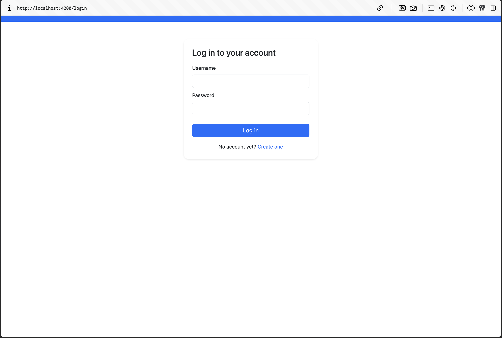  
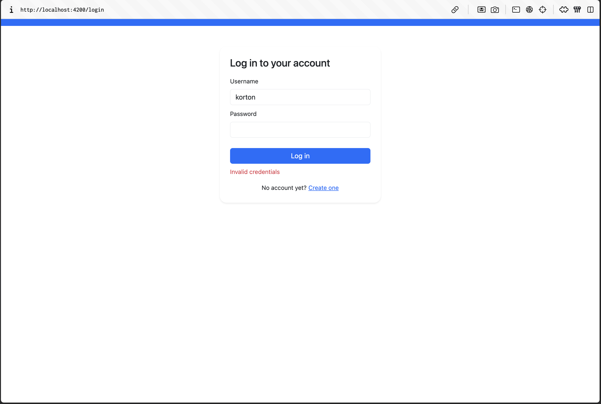  
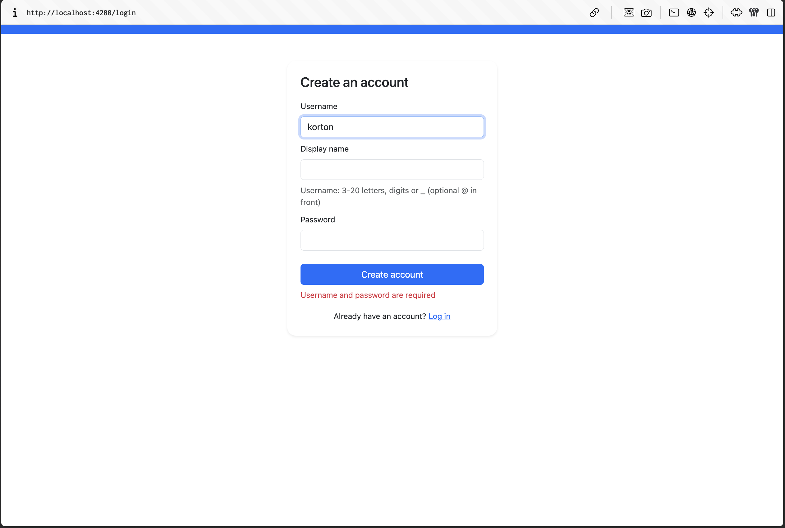  
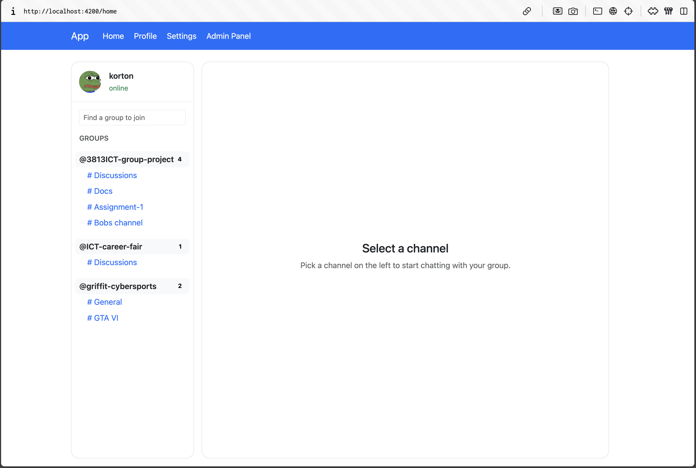  
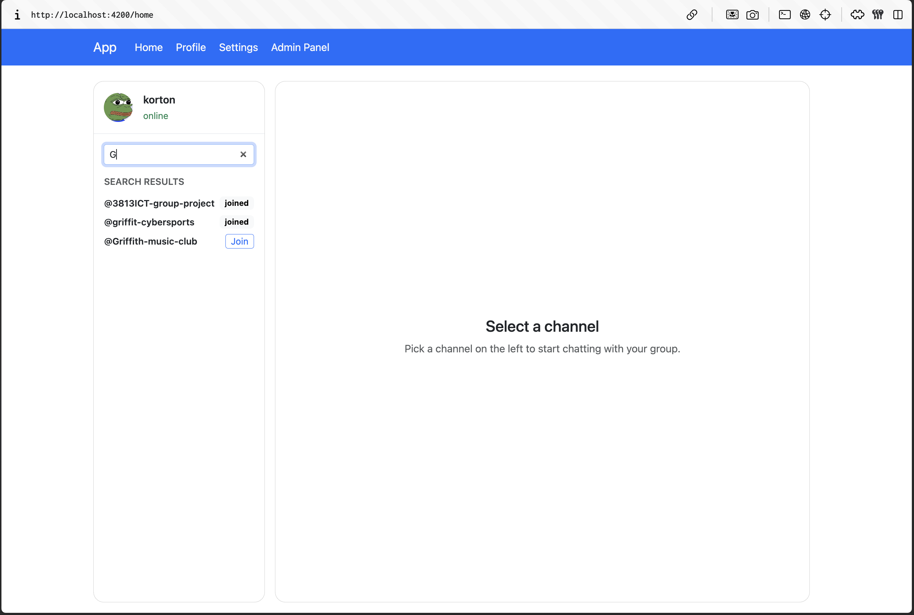  
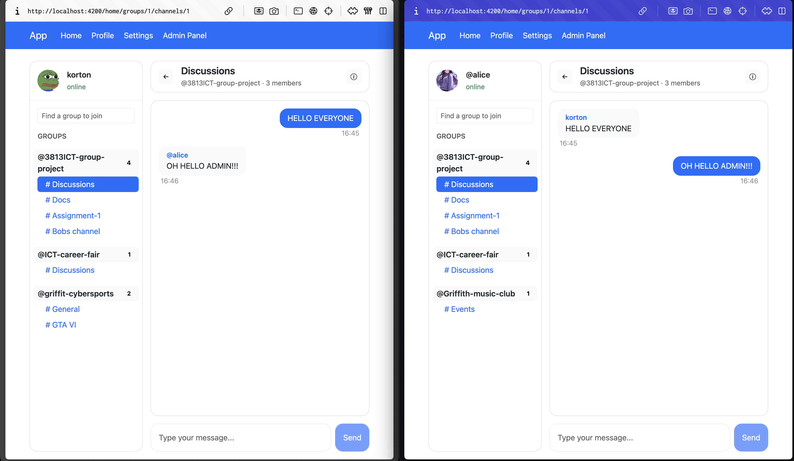  
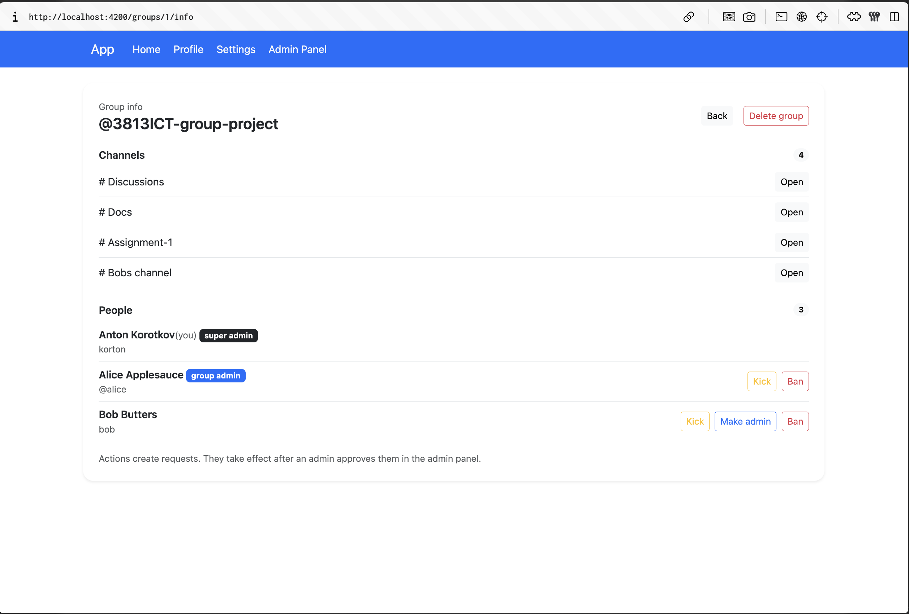  
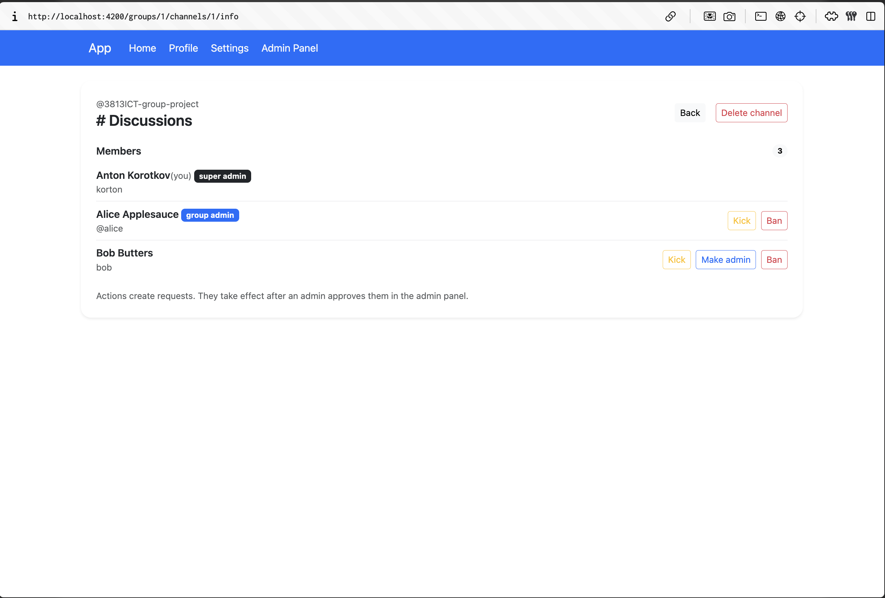  
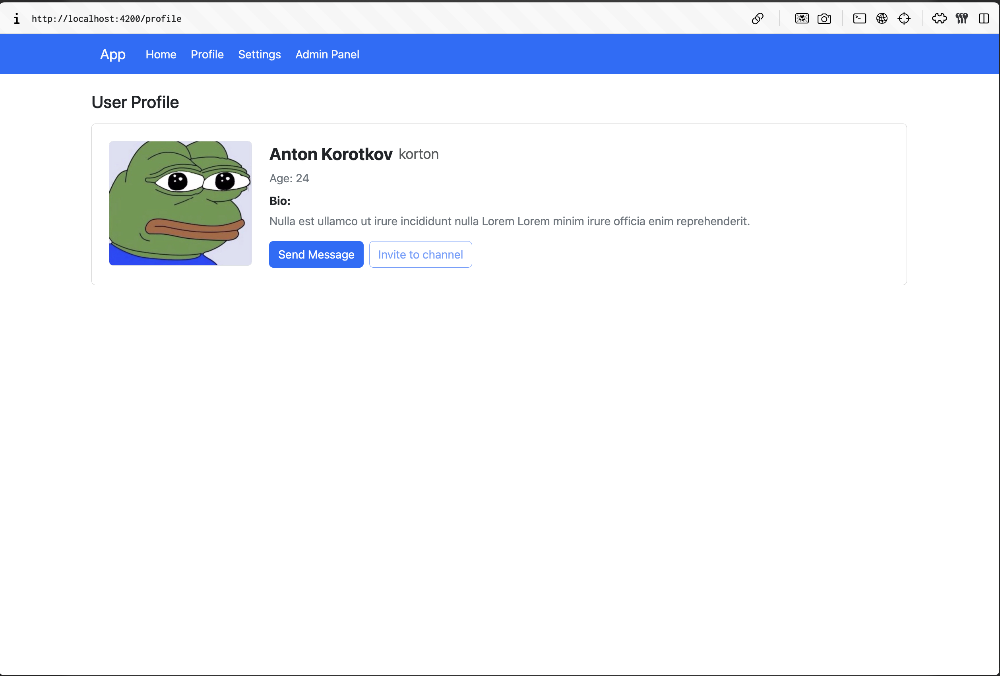  
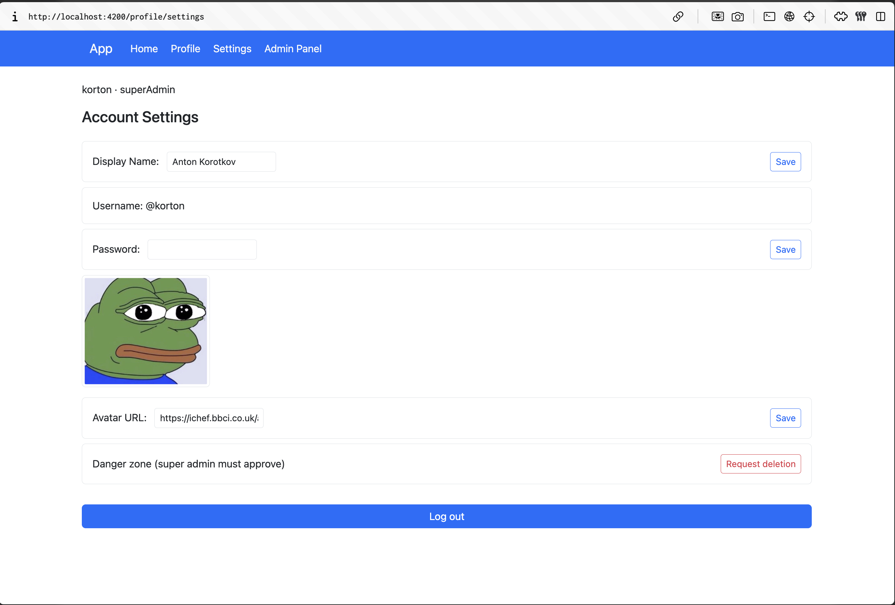  
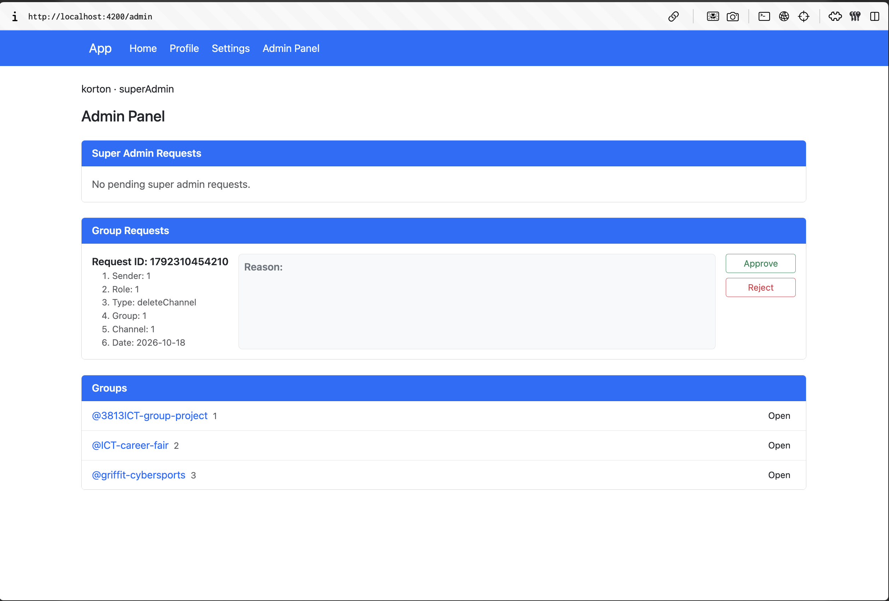

Phase 2 follows the same screens and layout as phase 1; changes: chat moved inside home (sidebar + chat on one page instead of a separate channel page), group search added to the sidebar, register mode added to login.

---


## 11. Known limitations

1. **Images** — avatar upload and images in chat messages are not implemented (`avatarUrl` is a text field, `Message.imageUrl` reserved).
2. **Security** — passwords stored as plain text (no hashing), no token: the client sends its own `userId` / `senderId`. Next step would be bcrypt + JWT and reading the user on the server from the token (also for sockets).
3. **Request execution** — only `createChannel` and `deleteAccount` are executed on approve; kick / ban / give admin / delete channel / delete group change only the request status. Execution runs in the client (`AdminRequestService.execute`), better place is the server.
4. Username can't be changed after registration.
5. No end-to-end tests.

  